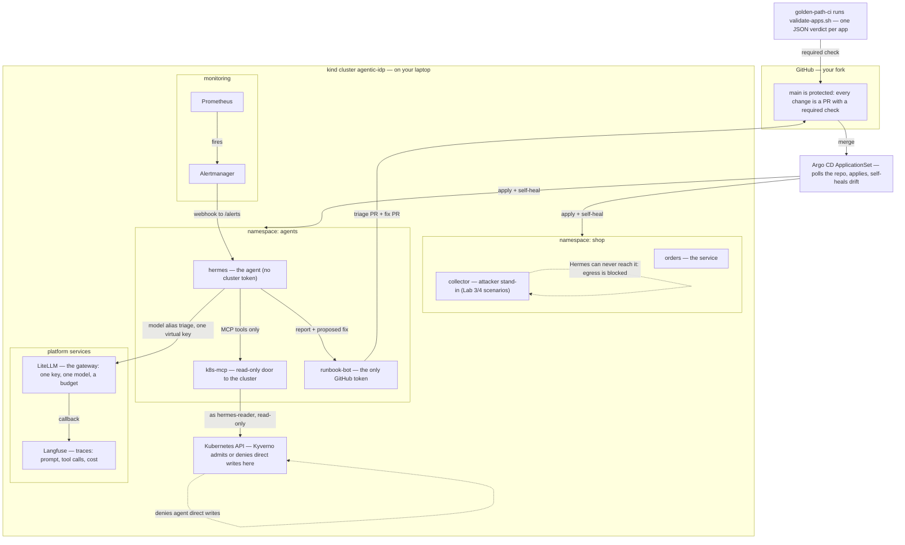
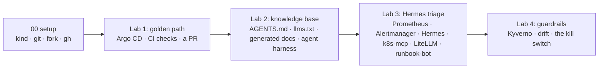

# The platform map: how the tools link together

The whole platform is a small number of moving parts. This page maps them and says what each one is, in one minute of reading, so the labs make sense **before** their first appearance. Read it once, and every lab becomes "I already know what this box does".

## The system, end to end

Read it once, top to bottom: a merge in Git is the only way anything changes (Argo CD applies it); a failure in `shop` becomes an alert; the alert becomes a triage; the triage becomes two pull requests back in Git. The loop closes on Git, and a human merges.

## The labs, in order, and the tools each one introduces

Each lab starts where the last one ended: `orders` is the one service, Hermes the one agent. No new apps mid-workshop.

## Meet the tools

One line each, in the order they appear.

| Tool | What it is | First appears |
|---|---|---|
| **kind** | The cluster itself, on your laptop. Everything below runs inside it, including the gateway and Langfuse. | 00 setup |
| **Git + `gh` (your fork)** | The only write path. `main` is protected: a PR with a passing check, no exceptions — humans and bots alike. | 00 setup |
| **Argo CD** | GitOps. An ApplicationSet watches the repo and applies every app folder; self-heal reverts anything applied outside Git. You will watch it bring a deleted policy back. | Lab 1 (demo), Lab 4 (drift) |
| **CI check (`validate-apps.sh`)** | Validates every app folder and prints one JSON line per app: `pass`, or `fail` with the reason. Required on `main`, so a broken `values.yaml` can never merge. | Lab 1 |
| **Agent harness** | The coding agent you use to read the knowledge base and open PRs. It reads `AGENTS.md` and `llms.txt` — the same docs the platform agent reads. | Lab 2 |
| **Prometheus + Alertmanager** | Detect the failure (crash loop, OOM, bad config) and route it: Prometheus fires, Alertmanager posts the alert to Hermes. | Lab 3 |
| **Hermes** | The agent. Built on [hermes-agent](https://github.com/NousResearch/hermes-agent) from Nous Research: a prompt in, tool calls out. It holds **no** cluster token and **no** GitHub token — only the LiteLLM key. It never merges anything. | Lab 3 |
| **k8s-mcp** | The Model Context Protocol server that is Hermes's only door to Kubernetes. Runs read-only (`read_only = true` in its config) and acts as `hermes-reader`: it can list pods, read events and logs — it cannot delete, and cannot read Secrets. | Lab 3 |
| **LiteLLM** | The model gateway, running inside your cluster. Hermes calls one alias (`triage`) with one virtual key that has a budget and a rate limit. It is also the **real kill switch**: block the key and every model call stops, everywhere, instantly. | Lab 3 (calls), Lab 4 (kill switch) |
| **runbook-bot** | A tiny bot that holds the only GitHub token. It opens the two PRs Hermes's output becomes (triage report + proposed fix) and can only write a fix to an existing `labs/*/apps/*/values.yaml`. It cannot merge. | Lab 3 |
| **Langfuse** | The observability side: every model call is traced — prompt, tool calls, tokens, cost. Read it in the observability section to see what a triage actually cost and did. | Lab 3 (observability) |
| **Kyverno** | A policy engine at the Kubernetes API server, admission-time. The workshop policy (`deny-agent-direct-changes`) says: agent identities may not create, update, or delete anything directly. RBAC can be misconfigured; Kyverno is the second layer that still says no. | Lab 4 |
| **NetworkPolicy** | Per-app egress rules, shipped in each app's `values.yaml`. Hermes can reach DNS, k8s-mcp, runbook-bot, and LiteLLM — and nowhere else. That is what makes the poisoned-log exfiltration check fail. | Lab 3 (egress check), Lab 4 (the weakening PR) |

## One-minute intros for the ones that catch people off guard

**Hermes.** Not a black box: it is [hermes-agent](https://github.com/NousResearch/hermes-agent), an open-source agent framework, pinned to an image we build. In the lab a small bridge (`alert_bridge.py`) listens for Alertmanager, hands Hermes the alert plus its runbook, and parses what Hermes writes back. That output is a structured triage report and, when Hermes is confident, a proposed fix to a `values.yaml` — which `runbook-bot` turns into pull requests. You do not configure its brain in the workshop; you govern what it can read, call, and send.

**k8s-mcp.** Model Context Protocol is the standard way a model talks to tools. `k8s-mcp` is the implementation that wraps the Kubernetes API in named tools (`list pods`, `get events`, `read logs`). Because it starts read-only and runs as `hermes-reader`, the agent's entire reach into the cluster is the read verbs of one narrow ServiceAccount — nothing to open a browser, no terminal, no `apply`.

**Kyverno.** A Kubernetes-native policy engine: rules that evaluate every request at the API server, before it happens. RBAC answers "may this identity call this verb on this resource?"; Kyverno answers questions RBAC cannot, like "may an **agent identity** write **this kind of object** at all?" In Lab 4 you see both: a misconfigured role that RBAC would let through, and the Kyverno policy that still refuses it.

**LiteLLM.** One address for many models. Hermes never sees a provider key or knows which provider serves the alias; it holds a virtual key that only works for one alias and has a hard budget. Two things follow: the model is swappable with a config change, and "stop the agent" is one admin call (`/key/block`) — the kill switch that survives Argo CD, because it is not in the cluster at all.

**Langfuse.** Traces, not logs. Every model call through LiteLLM produces a trace: the full prompt (so you can see the runbook was there), the tool calls (so you can see it read pods and events), and the token cost (so you can see what triage actually costs). Together with Git history and the Kyverno decisions, that is the audit story for what the agent did.

**Argo CD.** The reason "Git is the only write path" is true in practice, not just as a rule. It reconciles the cluster toward what is in the repo: merge a PR and it applies; delete a policy by hand and it is back in seconds. Labs 4 and the drift step are about this self-heal.

## Where each tool is used in the labs

| Lab | Golden path | Knowledge base | Triage | Guardrails |
|---|---|---|---|---|
| **What it does** | Ship `orders`: folder, PR, check, Argo | Docs the agent can trust: `llms.txt`, generated pages, freshness check | Break `orders`; watch Hermes triage; prove the leak cannot leave | Prove each layer: policy, drift, the approved hole, the real stop |
| **Tools on screen** | `gh`, `yq`, Argo CD UI, CI JSON | `generate-docs.sh`, agent harness, `llms.txt` | `break-orders.sh`, `kubectl logs`, LiteLLM, the two PRs | Kyverno dry-run, `delete networkpolicy`, the helpful PR, `kill-switch.sh` |

If a name in a lab is new, this page is where to look before asking.
