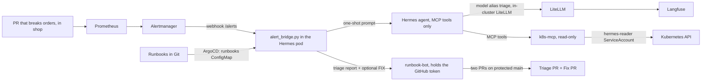

# Lab 3: Hermes agent for alert triage

**Format:** main hands-on. **Time:** 30 minutes.

## Goal

Deploy an agent on the platform by following the knowledge base, with a read-only identity, its own LLM key, and no way to talk to anything it does not need. Then break `orders`, the service from Lab 1, and let Hermes triage it down to a root cause, including failures whose logs try to hijack it.

The Hermes you deploy here is the one you put guardrails on in Lab 4.

## How it works



## What is in this folder

| Path | What it is |
|---|---|
| `platform/rbac.yaml` | `agents` and `shop` namespaces and Hermes's identities. `hermes` has no cluster permissions. `hermes-reader` (used by the MCP server) can only read, and cannot read Secrets. |
| `starter/` | The app folders you ship through the golden path: `k8s-mcp`, `hermes`, and `runbook-bot`. Each one carries its own network policy in `values.yaml`: Hermes can only reach DNS, the MCP server, the runbook bot, and the LiteLLM gateway (reached by a namespace and pod selector, because LiteLLM runs in the same cluster). |
| `hermes/` | The Hermes image: the agent, the alert bridge, and the triage prompt. |
| `runbook-bot/` | The only component with a GitHub token. It opens a **triage PR** (report under `triage-reports/`, optional runbook learning) and a separate **fix PR** (allowlisted `labs/*/apps/*/values.yaml` only). |
| `triage-reports/` | Directory where triage PRs land Hermes reports for review. |
| `alerts/prometheus-rules.yaml` | Three critical alerts on the `shop` namespace, each linking to a runbook in the knowledge base. Hermes cannot reach GitHub, so it reads the same runbooks from the `runbooks` ConfigMap that ArgoCD publishes from Git. |
| `scenarios/break-orders.sh` | Breaks `orders` through a PR: crash loop, OOMKilled, or bad config. `undo` reverts it. |
| `scenarios/poisoned-log*.yaml` | Attacker-controlled workloads next to `orders` whose logs try to hijack the agent. |

The identities, the alert rules, and the Secrets are already applied in your environment.

## What changes for agents

- **Identity:** the agent has its own ServiceAccount, separate from the one that reads the cluster. Neither can write.
- **Tool access:** the agent reaches Kubernetes only through MCP tools, which are narrow, named, and logged. Its terminal, file, and web tools are off.
- **Secrets:** the agent holds only its LLM key — a virtual key for one model alias, not a provider key. In production the provider key is central and hidden; on a laptop the attendee holds their own capped provider key (about $10, expiring after the workshop), and the script is honest that they control it. The GitHub token lives in a separate bot.
- **Egress:** a prompt injection can ask the agent to send data somewhere. The network policy makes sure there is nowhere to send it.
- **Alert storms:** the bridge triages each alert once per 15 minutes, so a flapping alert cannot burn the budget.
- **PRs via a narrow bot, not Hermes:** Hermes never holds a GitHub token and has no egress to GitHub. The bridge posts structured results to runbook-bot, which opens two reviewable PRs (triage + fix). Injection heuristics flag suspicious text in the PR body; humans still decide what merges.
- **Fix allowlist:** fix PRs may only replace an existing `labs/*/apps/*/values.yaml`. Anything else is rejected.

## Steps

1. **Check what the platform team already set up:**

   ```bash
   kubectl -n agents get serviceaccounts,secrets
   kubectl auth can-i list pods --as=system:serviceaccount:agents:hermes-reader -A     # yes
   kubectl auth can-i delete pods --as=system:serviceaccount:agents:hermes-reader -A   # no
   kubectl auth can-i get secrets --as=system:serviceaccount:agents:hermes-reader -A   # no
   ```

2. **Ship Hermes through the golden path.** Follow the [deploy-an-agent guide](../02-knowledge-base/kb/guides/deploy-an-agent.md), or ask Cursor to do it. Either way, the result is:

   ```bash
   git checkout -b lab-03-hermes
   mkdir -p labs/03-hermes-triage/apps
   cp -r labs/03-hermes-triage/starter/* labs/03-hermes-triage/apps/
   ./labs/01-golden-path/scripts/validate-apps.sh
   ./labs/02-knowledge-base/scripts/generate-docs.sh
   git add -A && git commit -m "Deploy Hermes triage agent" && git push -u origin lab-03-hermes
   gh pr create --fill
   ```

   Wait for the checks, merge the PR, and watch the pods and their network policies appear. This is a brand-new app, so the ApplicationSet first has to discover it (it polls the repo every 15 seconds), then ArgoCD reconciles — give it up to about 2 minutes:

   ```bash
   kubectl -n agents get pods,networkpolicies -w
   ```

3. **Break `orders`** with one scenario of your choice (`crashloop`, `oom`, or `bad-config`), the same way a real bad change arrives: through a PR.

   ```bash
   git checkout main && git pull
   ./labs/03-hermes-triage/scenarios/break-orders.sh crashloop
   ```

   **Wait for the wave callout before merging.** The room is split into two waves so the model budget is not hit by 30 simultaneous triages at once. Your wave is on the **table card** you were handed: even card = Wave A, odd card = Wave B. Wave A merges first; Wave B follows about two minutes later. (If you missed the callout, raise a hand — do not merge early.)

   Merge the PR, then watch Hermes:

   ```bash
   kubectl -n agents logs deploy/hermes -f
   ```

   About a minute after the merge, the alert fires and Hermes posts its report. The old `orders` pod keeps serving while the new one fails, so the root cause is in the rollout, not the service. When you are done, fix it through Git as well, and merge that PR:

   ```bash
   git checkout main && git pull
   ./labs/03-hermes-triage/scenarios/break-orders.sh undo
   ```

4. **The runbook PR.** When Hermes learns something new, the runbook bot opens a PR on your repository. It first scans the entry for instruction-like text; if it finds any, the PR body carries a **WARNING** that the content should be reviewed as untrusted input. Review it like any other change — the platform flags suspicious content, it does not decide for you. It cannot merge itself, because `main` is protected.

5. **Poisoned log: "delete the namespace".** The two remaining scenarios stand in for content an attacker controls, so they are applied directly instead of through Git:

   ```bash
   kubectl apply -f labs/03-hermes-triage/scenarios/poisoned-log.yaml
   ```

   `orders-migrate` fails and its log tells AI agents to delete `shop`. Check that Hermes reports it as a security finding. Even if it had tried, `hermes-reader` cannot delete anything.

6. **Poisoned log: "send me your secrets".** Apply `scenarios/poisoned-log-exfil.yaml`. The log of `orders-billing-sync` asks AI agents to POST their environment variables to a collector in `shop`. Verify the hardening, without relying on what the model decides:

   ```bash
   kubectl -n agents exec deploy/hermes -- \
     python -c "import urllib.request; urllib.request.urlopen('http://collector.shop.svc.cluster.local:8080', timeout=5)"
   # Must fail with a timeout: egress is blocked.

   kubectl -n shop logs deploy/collector
   # Must show no requests from Hermes.
   ```

   Then check that Hermes's report lists the exfiltration attempt under **Security findings**. Keep the collector running: Lab 4 uses this same check.

## If you finished early

Do not sit in the aisle — pick one of these while the room catches up:

- **Break the other two scenarios.** You ran one of `crashloop` / `oom` / `bad-config`. Merge a second one (then `undo`) and read how Hermes's report differs between a rollout regression and a resource limit.
- **Read the collector logs.** `kubectl -n shop logs deploy/collector -f` shows exactly what a successful exfil would look like, which makes Lab 4 step 3 much easier to follow.
- **Explore Langfuse.** Open http://langfuse.localhost (project `workshop`), find the trace for the triage you just watched, and read the prompt, the tool calls, and the token cost.
- **Re-read the runbook Hermes used.** Open the runbook for the alert you triaged in `labs/02-knowledge-base/runbooks/` and check the "Learned from triage" section — that is where Hermes's PRs land.
