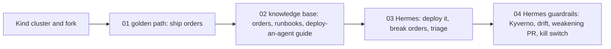

# Labs

Hands-on labs for **Building Agent-Ready Internal Developer Platforms**.

Every attendee runs the platform **on their own laptop**, in a [kind](https://kind.sigs.k8s.io/) cluster, against a **fork of the public workshop repository**. You set it up with [`00-setup/local`](00-setup/local/) before the session.

| Folder | Lab | Format | Time in session |
|---|---|---|---|
| [00-setup](00-setup/) | Connect to your environment | Before the session | 5 min |
| [01-golden-path](01-golden-path/) | Ship a service through the golden path | Guided demo, one "try it" step | 5 min of the 20-min section |
| [02-knowledge-base](02-knowledge-base/) | Self-documenting knowledge base | Guided demo, one "try it" step | 5 min of the 15-min section |
| [03-hermes-triage](03-hermes-triage/) | Deploy Hermes and let it triage `orders` | **Main hands-on** | 30 min |
| [04-guardrails-recovery](04-guardrails-recovery/) | Guardrails for Hermes: policy, drift, a bad PR, and the kill switch | Hands-on | 20 min of the 30-min section |

Langfuse has no lab folder. Bootstrap installs it in your cluster, and the session walks through the traces there.

## Storyline

There is one service and one agent for the whole workshop:

- **`orders`**, in the `shop` namespace, is the service. Lab 1 ships it through the golden path, and Lab 2 documents it.
- **Hermes**, in the `agents` namespace, is the agent that operates it. Lab 3 deploys Hermes and breaks `orders` so Hermes can triage it. Lab 4 checks Hermes's guardrails, watches a PR weaken them, and recovers.

Each lab ends in the state the next one starts from, so there are no new apps to learn along the way.

## Your environment starts after Lab 2

When your local cluster is running, it already has:

- ArgoCD, Prometheus and Alertmanager, and Kyverno installed in your kind cluster.
- The golden path ApplicationSet registered, with `orders` deployed.
- The knowledge base generated and committed, and the runbooks published to the cluster.
- Hermes's identities, alert rules, and Secrets created by the platform team. Its network policy ships with Hermes itself in Lab 3.

So Labs 1 and 2 are demos you can follow along with, and nothing in Labs 3 and 4 depends on finishing them.

## How the labs fit together

- Every app (including Hermes) is deployed the same way: a folder under `labs/*/apps/<name>/` with an `app.yaml` and a `values.yaml`, picked up by the ArgoCD ApplicationSet.
- Git is the only write path. `main` is protected on your fork: every change needs a PR with passing checks, for humans and bots alike.
- There is **no webhook**. ArgoCD polls: a change to an existing app is applied on the next 30-second reconciliation, and a brand-new app is discovered by the ApplicationSet, which polls the repository every 15 seconds for new `app.yaml` files. A hard refresh (`kubectl -n argocd annotate application <app> argocd.argoproj.io/refresh=hard --overwrite`) skips the wait.
- For the full system map — every tool, what it is, and where it first appears — read [the platform map](02-knowledge-base/kb/guides/platform-map.md). It is in the knowledge base on purpose: it is the same map the agent is pointed at.

## Prerequisites

- A laptop with Docker configured for 12 GB of memory (16 recommended) and 4 CPUs.
- `kubectl`, `git`, the `gh` CLI (2.50 or newer — Lab 1 uses `gh pr checks --watch`), `helm`, `kind`, `yq` (mikefarah 4.x), `jq`, `envsubst`, `kubeconform`, and `helm-docs`.
- An agent harness (a coding agent that can read the repo and run commands), with a plan that allows agent use.
- A fork of the public upstream repository. `GH_REPO` must point at your fork so `gh` targets it, not the upstream.

**Check yourself (or let the agent check you):** `./labs/00-setup/local/preflight.sh` prints one JSON line per check — Docker running, memory, CPUs, disk, every tool with the right version, `gh` login, `GH_REPO` fork — plus a summary and a non-zero exit while anything fails. Ask your agent harness to "read `labs/02-knowledge-base/kb/guides/onboarding.md` and get this environment running" and it will run that loop for you: read the failures, fix them, re-run, then bootstrap and verify.

If your laptop breaks, reset it with `kind delete cluster --name agentic-idp` and re-run [the bootstrap](00-setup/local/bootstrap.sh). Setup steps: [00-setup/local](00-setup/local/).
